  
  
  
  

I build **AI systems that can show their sources** — retrieval pipelines that refuse to guess, vision models that check their own output — and the infrastructure that puts them in production.

Data Engineering @ **IIT Madras** · Computer Science @ **Medhavi Skills University** · I write poetry when I'm not writing code.

## Things I've shipped

<table>
  <tr>
    <td width="50%" valign="top">
      <h3><a href="https://github.com/BIS-Standards-AI-Assistant/BIS">BIS Standards Navigator</a></h3>
      Smart India Hackathon 2026 · SIH26107
      
An evidence-first assistant for Indian Standards. Ask "which standard covers steel water bottles?" and it answers with the document, page and clause behind every claim — or says plainly that it can't find one.

      
<code>Next.js</code> <code>pgvector</code> <code>Drizzle</code> <code>Vercel AI SDK</code> <code>Playwright</code>

      
Top contributor · <a href="https://bis-standards-client.vercel.app">Live demo</a>

    </td>
    <td width="50%" valign="top">
      <h3><a href="https://github.com/SIH-2026-Celestials/pulli_kolam">PULLI</a></h3>
      Smart India Hackathon 2026 · Kolam design principles
      
Turns hand-drawn South Indian <i>pulli kolam</i> into graphs: measures symmetry and motifs, verifies single-stroke correctness, and generates new designs. Classical CV and a learned detector, served side by side.

      
<code>Python</code> <code>FastAPI</code> <code>React</code> <code>Docker</code>

      
Top contributor · <a href="https://pulli-kolam.vercel.app">Live demo</a>

    </td>
  </tr>
  <tr>
    <td width="50%" valign="top">
      <h3><a href="https://github.com/Abhishek1106kr/ehr-core">OpenEHR Bridge</a></h3>
      Healthcare workflow engine · in progress
      
Automates a hospital front desk: patient registration, appointments and insurance checks behind a REST API with role-based access and audit logs, plus a FHIR adapter and a browser-automation fallback.

      
<code>TypeScript</code> <code>FHIR</code> <code>Docker</code>

    </td>
    <td width="50%" valign="top">
      <h3><a href="https://github.com/Abhishek1106kr/GeoTera">GeoTera</a></h3>
      Live world-data dashboard
      
News, markets, climate and population pulled from open APIs and RSS on a schedule, then pushed to the browser over WebSocket the moment they change.

      
<code>FastAPI</code> <code>APScheduler</code> <code>WebSocket</code> <code>Next.js</code>

    </td>
  </tr>
</table>

Also: [RAG](https://github.com/Abhishek1106kr/RAG) (Gemini + ChromaDB, [try it](https://jrfvvy5kac46eyjrja3ycv.streamlit.app/)) · [APIPEDIA](https://github.com/Abhishek1106kr/apiPedia) · [FinanceOS](https://github.com/Abhishek1106kr/finops)

## Open source

- **[pandas](https://github.com/pandas-dev/pandas/pulls?q=is%3Apr+author%3AAbhishek1106kr)** — documentation fixes: regex handling of `pat` in `str.split` / `str.contains`, and `make.py --single` for objects referenced by module path *(in review)*
- **[BIS Standards Navigator](https://github.com/BIS-Standards-AI-Assistant/BIS/pulls?q=is%3Apr+author%3AAbhishek1106kr+is%3Amerged)** — TTS in every answer language, i18n and API fixes, and a guard that stops the assistant inventing "Gazetted" editions
- **[PULLI](https://github.com/SIH-2026-Celestials/pulli_kolam/pulls?q=is%3Apr+author%3AAbhishek1106kr+is%3Amerged)** — structural generation pipeline, ML detector API, real-photo validation and production hardening

## Stack

Currently: getting my pandas PRs merged and picking up good first issues in MIT-licensed projects.
